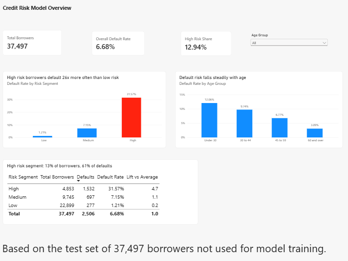
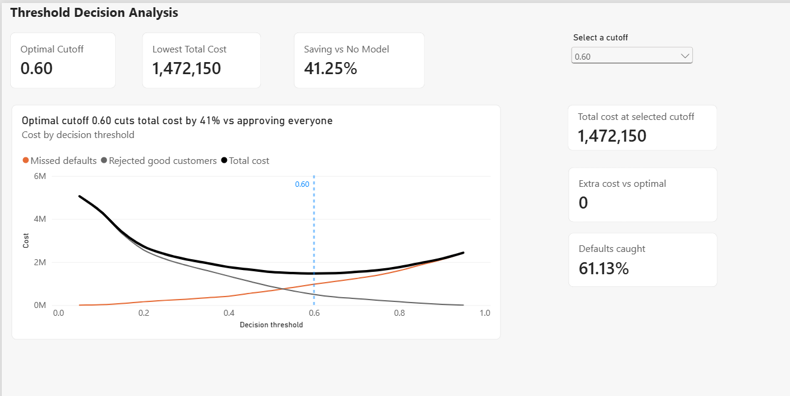

# Credit Risk Prediction Project

This project predicts which borrowers are likely to default on a loan, and then uses those predictions to help a lender decide who to approve. I used SQL to clean the data, Python to build the model, and Power BI to show the results.

## Key Results

* The model ranks risky borrowers well: AUC of 0.87 (a simple baseline model scored 0.82).
* The best decision cutoff is 0.60. At that point, total cost is 41% lower than approving everyone.
* The model catches 61% of defaults while rejecting fewer than 10% of good customers.
* The high risk group is only 13% of borrowers, but contains 61% of all defaults.

## The Problem

A lender can make two kinds of mistakes:

* **Approving someone who doesn't pay back** → the lender loses the loan.
* **Rejecting someone who would have paid back** → the lender loses the interest it could have earned.

So the goal is not just to predict default, but to find the decision rule that costs the lender the least money.

The dataset has 150,000 borrowers. "Default" means being 90 or more days late on a payment within two years.

## What I Did

**1. Cleaned the data with SQL**
I loaded the data into a SQLite database and checked every column for problems:
* Monthly income was missing for about 20% of borrowers.
* Some late payment columns had the values 96 and 98. These were codes, not real counts, so I removed them.
* I removed borrowers younger than 18 or older than 100.

**2. Prepared the features in Python**
* For missing income, I added a column that says "income was missing", so the model can learn from that too.
* I created three new features: total number of late payments, whether the borrower was ever 90+ days late, and income per family member.

**3. Built and compared two models**
* Logistic Regression (simple baseline): AUC 0.82
* Random Forest (final model): AUC 0.87

Only about 7% of borrowers default, so I told both models to give extra weight to the default cases. Otherwise they would mostly learn to predict "no default".

**4. Chose the best decision cutoff**
The model gives each borrower a risk score. The lender must decide above which score to reject. Instead of using the standard cutoff of 0.5, I tested every cutoff and calculated the total cost, assuming:
* 1,000 lost for each approved borrower who defaults
* 150 lost for each good customer who is rejected

The lowest total cost is at a cutoff of **0.60**. These cost numbers are examples; a real lender would use its own.

**5. Built a Power BI dashboard**
All numbers in the dashboard come from the test set: 37,497 borrowers the model never saw during training.

## Dashboard

### Page 1: Model Overview
Checks if the model makes sense. Borrowers the model marks as high risk really do default much more often: 31.6% compared with 1.2% for low risk borrowers. Younger borrowers also default more often than older ones.

### Page 2: Threshold Decision Analysis
Shows how the cost changes with the cutoff. A strict cutoff rejects too many good customers. A loose cutoff lets too many defaulters through. The black line shows the total cost, with its lowest point at 0.60. You can pick any cutoff and see what it would cost.

## Limitations and Next Steps

* The cost numbers are assumptions. A lender would replace them with real figures.
* The model's scores show who is riskier than whom, but they are not exact probabilities. Calibrating the model would fix that.
* The model uses age. In the EU, credit scoring is seen as high risk under the AI Act, so a real model would need checks to make sure it treats groups fairly.
* The data is from 2011, so a real model would need newer data and regular retraining.

## Tools

SQL (SQLite), Python (pandas, NumPy, scikit learn), Power BI

## How to Run

1. Download `cs-training.csv` from the [Give Me Some Credit](https://www.kaggle.com/c/GiveMeSomeCredit/data) competition on Kaggle and rename it to `credit_risk_training.csv`.
2. Install the packages: `pip install pandas numpy scikit-learn`
3. Run `credit_risk_project.ipynb`. It cleans the data, trains the models, and creates the two CSV files used in Power BI.
4. 
